<!-- Generated by scripts/bento.ts -->

<a href="https://vastamaki.dev/"><picture><source media="(max-width: 767px)" srcset="./assets/intro-mobile.svg" /></picture></a><a href="https://vastamaki.dev/"><picture><source media="(max-width: 767px)" srcset="./assets/about-mobile.svg" width="100%" /></picture></a><a href="https://github.com/vastamaki"><picture><source media="(max-width: 767px)" srcset="./assets/details-mobile.svg" width="100%" /></picture></a><a href="https://github.com/vastamaki?tab=repositories"><picture><source media="(max-width: 767px)" srcset="./assets/languages-mobile.svg" /></picture></a><a href="https://www.linkedin.com/in/viljami-vastamaki"><picture><source media="(max-width: 767px)" srcset="./assets/linkedin-mobile.svg" /></picture></a><a href="https://x.com/vastamaki"><picture><source media="(max-width: 767px)" srcset="./assets/x-mobile.svg" /></picture></a>

